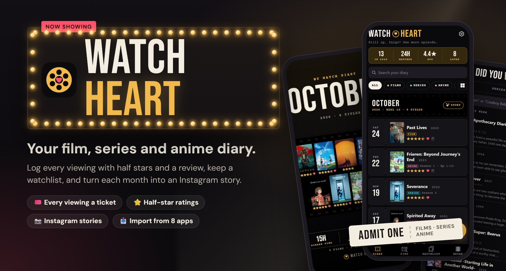
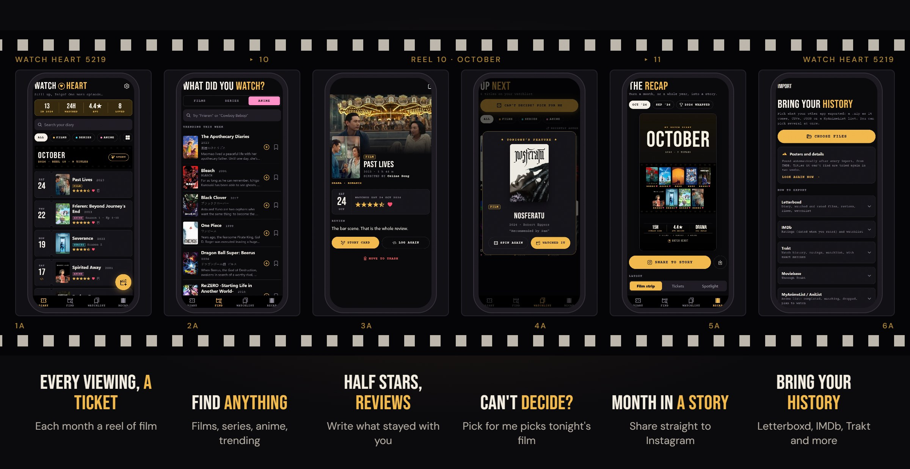
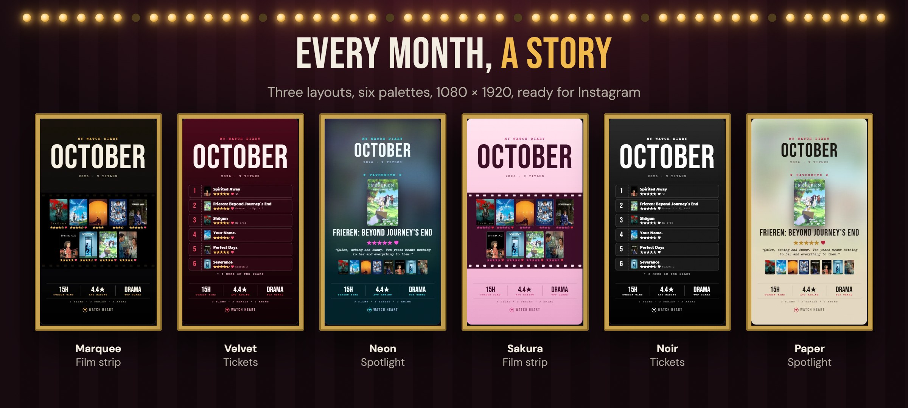
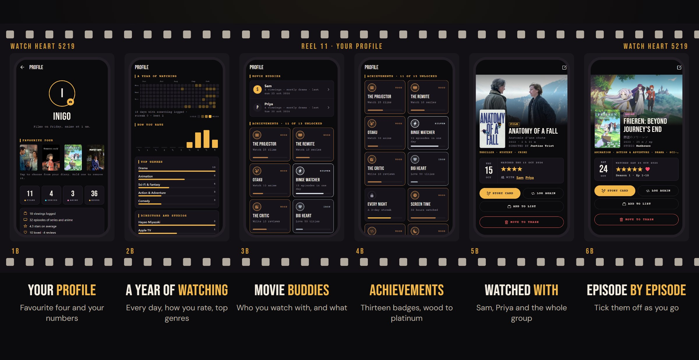

<p align="center">
  
</p>

<p align="center">
  <a href="../../releases/latest/download/watch-heart.apk"></a>
  <a href="https://inigo-code.github.io/watch-heart-site/fdroid.html"></a>
  <a href="https://inigo-code.github.io/watch-heart-site/"></a>
  
  
  
  
  
</p>

<h3 align="center">Every viewing, a ticket. Every month, a story.</h3>

<p align="center">
<b>Watch Heart</b> is a diary for everything you watch: the film on Friday, the series you finish on Sunday,<br/>
the anime you swear is the last episode at 1 am. Log it with half stars and a review,<br/>
keep a watchlist, and turn each month into an <b>Instagram story</b>. Free, with no ads.
</p>

<br/>

## 🎬 Highlights

<table>
  <tr>
    <td width="33%" valign="top">
      <h4>🎟️ A diary on film</h4>
      Every month is a reel of film and every viewing a ticket stub with the date, poster, stars, heart and review. Or switch to a poster wall.
    </td>
    <td width="33%" valign="top">
      <h4>🔎 Find anything</h4>
      Films, series and anime in one search, with what's trending this week before you type, and <b>Discover</b> to browse by service, genre, decade, language or country.
    </td>
    <td width="33%" valign="top">
      <h4>⭐ Half stars, real reviews</h4>
      Slide across the stars to rate, heart the ones you love, mark rewatches, note <i>Season 2 · Ep 1–8</i>, and hide spoilers behind a tap.
    </td>
  </tr>
  <tr>
    <td valign="top">
      <h4>📸 Month in a story</h4>
      Any month, or <i>2026 wrapped</i>, as a 1080 × 1920 story: three layouts, six palettes, ratings, stats or a ranking. Share to Instagram or save to Photos.
    </td>
    <td valign="top">
      <h4>🍿 Can't decide?</h4>
      Bookmark what you want to watch. When nobody can choose, <b>Pick for me</b> shows tonight's feature. Logging it takes it off the list.
    </td>
    <td valign="top">
      <h4>🔗 Share it in</h4>
      Share a link from IMDb, Letterboxd, TMDB, MyAnimeList or Chrome and Watch Heart opens it, ready to log.
    </td>
  </tr>
  <tr>
    <td valign="top">
      <h4>📥 Bring your history</h4>
      Import from Letterboxd, IMDb, Trakt, Moviebase, MyAnimeList, AniList, Netflix, Refract, Serializd and TV Time. Posters are found on their own.
    </td>
    <td valign="top">
      <h4>☁️ Sync &amp; backup</h4>
      Optional account to keep your diary on every device. Works offline. JSON backup, CSV export and a Letterboxd-ready file.
    </td>
    <td valign="top">
      <h4>🌗 Projector or Paper</h4>
      A dark projector look or a light paper one, five accents, fingerprint App lock, and a 30-day Trash with undo.
    </td>
  </tr>
  <tr>
    <td valign="top">
      <h4>🏆 Your profile</h4>
      Your favourite four, films, series, anime and hours, a year of watching day by day, how you rate, top genres, and thirteen achievements from wood to platinum.
    </td>
    <td valign="top">
      <h4>👥 Watched with</h4>
      Add who was there to any viewing. <b>Movie buddies</b> on your profile shows who you watch with most, and searching a name finds everything you saw together.
    </td>
    <td valign="top">
      <h4>📺 Episode by episode</h4>
      Tick off episodes as you go, season by season, and pick up where you left off from the Diary.
    </td>
  </tr>
  <tr>
    <td valign="top">
      <h4>🍅 Scores at a glance</h4>
      IMDb, Rotten Tomatoes and Metacritic scores on every title, next to your own stars.
    </td>
    <td valign="top">
      <h4>📡 Where to watch</h4>
      Which services stream, rent or sell a title in your country, from JustWatch.
    </td>
    <td valign="top">
      <h4>🪪 Profile card</h4>
      Your profile as an Instagram story in any of the six palettes. Your name, bio and photo follow you to your other phones.
    </td>
  </tr>
  <tr>
    <td valign="top">
      <h4>📋 Your own lists</h4>
      <i>Best of 2026</i>, <i>Ghibli ranked</i>: make lists from your diary or any title, number them if you like, and share one as a story.
    </td>
    <td valign="top">
      <h4>🎭 Title pages</h4>
      Synopsis, cast and crew, trailer, seasons, <i>You might like</i> and <i>By the same director</i>. Tap anyone for their filmography, with what you've seen ticked.
    </td>
    <td valign="top">
      <h4>💬 More than stars</h4>
      Tag a viewing with up to five vibes, where you watched, on what, which service, and your favourite character. Your profile counts them up.
    </td>
  </tr>
  <tr>
    <td valign="top">
      <h4>🤝 Friends</h4>
      Share your invite code to see each other's diaries, reviews and lists, and which friends have seen a title before you press play. You choose what they see.
    </td>
    <td valign="top">
      <h4>📱 Up next widget</h4>
      Your next episode, or the top of your watchlist, on your home screen. Tap to pick up where you left off; + to log something.
    </td>
    <td valign="top">
      <h4>🗂️ Discover</h4>
      Hidden gems, miniseries to binge, anime airing now and a shelf for the season, then switch any of them between films, series and anime.
    </td>
  </tr>
</table>

<br/>

<p align="center">
  
</p>

<p align="center">
  
</p>

<p align="center">
  
</p>

## ⬇️ Install

### With F-Droid (recommended, updates automatically)

1. Install [F-Droid](https://f-droid.org) (or Neo Store / Droid-ify) on your phone.
2. Open the **[Watch Heart F-Droid page](https://inigo-code.github.io/watch-heart-site/fdroid.html)** on your phone and tap **Add to F-Droid**, or scan its QR code from another screen.
3. Search for **Watch Heart** in F-Droid and install it. New versions show up in F-Droid like any other app.

<details>
<summary>Add the repository by hand</summary>

In F-Droid, go to **Settings → Repositories → +** and enter:

- **Address:** `https://inigo-code.github.io/watch-heart-site/fdroid/repo`
- **Fingerprint (SHA-256):** `14F917D7046ACF9C7709C426D8B91B4375B4BF7860CC0BE5601C58C9BF8F68FB`

F-Droid checks the repository against this fingerprint, so you only ever get APKs signed for Watch Heart.
</details>

> Watch Heart is in its own F-Droid repository, not the main F-Droid one, so it only shows up in F-Droid's search after you add the repository.

### Direct download

1. On your Android phone, tap **[Download APK](../../releases/latest/download/watch-heart.apk)** (or open the [latest release](../../releases/latest)).
2. Open the file. If Android asks, allow your browser to install apps. If Play Protect warns, choose **Install anyway**.
3. That's it. New versions install over the old one and keep your diary.

Both ways install the same signed APK, so you can switch between them without losing anything. Smaller updates also arrive inside the app by themselves.

> Watch Heart asks for very little: **Internet**, for search, posters, sync and updates; **Biometric**, only if you turn on App lock; and permission to **save** stories to Photos. It can't read your gallery.

## 🔒 Your data

- **On your phone first.** Your diary, watchlist and settings live on the phone and work without an account.
- **Private sync.** With an account, your diary, watchlist, episode progress and profile sync through Supabase. Row Level Security means every account can read only its own rows, and profile photos sit in a private bucket under your own folder.
- **Friends see only what you share.** Friends are made by invite code, both ways. They never read your tables: a few server functions check the friendship and return just what you share (diary, reviews, lists; each can be switched off). Who you watched with and your tags are never shared.
- **Leave any time.** Export a backup, a spreadsheet or a Letterboxd file, or [delete your account](https://inigo-code.github.io/watch-heart-site/delete-account.html) in the app.
- **No ads, no analytics, no tracking.** See the [privacy policy](https://inigo-code.github.io/watch-heart-site/privacy.html).

## 📥 Importing from other apps

Settings → **Import from other apps**, then pick the file your old app exported, as it comes (a .zip, CSV, JSON or XML). You can pick several at once, and importing again never makes doubles. Titles without a poster are matched against TMDB in the background, and those it can't place are tried again after two weeks. The app's Import screen has step-by-step export guides.

| App | What comes across |
| --- | --- |
|  Letterboxd | Diary, ratings, reviews, likes, watched films, watchlist |
|  IMDb | Ratings (dated when you rated) and watchlist |
|  Trakt,  Moviebase (through Trakt) | History, ratings, watchlist, with exact matches |
|  MyAnimeList,  AniList | Completed, watching, on hold and dropped, with episodes; plan to watch goes to the watchlist |
|  Netflix | Viewing activity, with series grouped per day |
|  Refract,  Serializd,  TV Time | Any CSV or JSON export: titles, dates, ratings, reviews |

<sub>Logos from <a href="https://simpleicons.org">Simple Icons</a> (CC0); each belongs to its owner. Watch Heart isn't affiliated with any of these apps.</sub>

Entries without a watch date go to an **Archive** at the end of the diary instead of a made-up date.

## 🎞️ Free data sources

| Kind | Source | Key |
| --- | --- | --- |
| Films, series and anime | [TMDB](https://www.themoviedb.org) | Free personal key |
| Series and trending | [TVmaze](https://www.tvmaze.com) | None |
| Anime | [AniList](https://anilist.co) | Off until AniList gives permission |
| IMDb, Rotten Tomatoes and Metacritic scores | [OMDb](https://www.omdbapi.com) | Free personal key |
| Where to watch | [JustWatch](https://www.justwatch.com), through TMDB | The TMDB key |

Film and anime search need a TMDB key. Builds bake one in with `EXPO_PUBLIC_TMDB_KEY` (see `.env.example`), or paste your own into **Settings → Film and anime search** in the app. The app talks to `api.tmdb.org`, which also works on networks that block `api.themoviedb.org`.

Keeping to the terms:

- **TMDB** (free for non-commercial use): the About screen shows TMDB's logo and its required notice, and TMDB details are refreshed after about 5 months and never kept longer than 6 (`src/lib/tmdbFreshness.ts`). Ads or paid features would need a commercial agreement with TMDB first.
- **AniList** bars "anime and manga list or tracker services" from its API, so it stays off (`ANILIST_ALLOWED` in `src/lib/app.ts`) unless AniList gives written permission.
- **TVmaze** (CC BY-SA) only asks for a link back, which is on the About screen.
- **JustWatch** streaming data comes through TMDB and is credited to JustWatch wherever it's shown.

<sub>Watch Heart uses TMDB and the TMDB APIs but is not endorsed, certified, or otherwise approved by TMDB.</sub>

## 🛠️ Run it

```bash
npm install
npx expo start
```

Scan the QR code with **Expo Go** on Android. Everything works in Expo Go except share-in, the home-screen widget and the App lock privacy screen (a small native module in `modules/app-privacy`, as in Prompt Heart), which need a development build:

```bash
npx eas-cli@latest build --profile development --platform android
```

`npx expo start --web` opens a design preview in the browser. It keeps the diary in localStorage (`src/store/db.web.ts`) and can't save stories to Photos.

### Build and release

The EAS profiles match Prompt Heart's: `preview` builds an installable APK and `production` builds an AAB for Google Play. JavaScript changes ship over the air:

```bash
npx eas-cli@latest update --channel preview --platform android --environment preview --message "What changed"
```

New native code needs a new build. Attach the APK to a GitHub release as `watch-heart.apk`, so the website's download buttons always fetch the newest one, then publish it to the F-Droid repository with `publish.sh` in the `Watch Heart F-Droid` folder next to this one (its README explains the signing key, which stays private).

Accounts and sync need a free Supabase project; see [supabase/SETUP.md](supabase/SETUP.md).

### Code map

- `src/app`: screens (Expo Router). `(tabs)` holds Diary, Find, Watchlist and Recap; `title`, `person` and `browse` are the title pages and Discover.
- `src/api`: TMDB, TVmaze and AniList clients, and link resolving for share-in.
- `src/store`: the diary and watchlist (SQLite on the phone) and their types.
- `src/lib/import`: the importers, one per app, and file detection.
- `src/lib/tmdbFreshness.ts`: background poster matching and TMDB upkeep.
- `src/sync`, `supabase/`: accounts and cloud sync, and the server schema.
- `src/friends`, `supabase/friends.sql`: invite codes, friends, and what friends can see.
- `src/widget`, `index.ts`: the Up next home-screen widget (react-native-android-widget).
- `src/story`: the Instagram story canvas, review card, palettes and share/save.
- `src/components`: film-styled UI (posters, stars, ticket stubs, reel headers).
- `src/lock`, `modules/app-privacy`: App lock, from Prompt Heart.
- `scripts/make-icons.mjs`: renders the app icons.

<p align="center"><sub>Made by Inigo, who also makes <a href="https://github.com/inigo-code/prompt-heart">Prompt Heart</a>.</sub></p>
